# E-commerce Modern Data Stack Pipeline

[](https://github.com/kzurawska8/ecommerce-mds-pipeline/actions/workflows/ci.yml)
[](https://kzurawska8.github.io/ecommerce-mds-pipeline/)

An end-to-end **ELT pipeline** on the Modern Data Stack: Snowflake provisioned with
**Terraform**, a containerized **Python** loader that lands raw API data in Snowflake,
**dbt** models with tests and contracts on top, and **GitHub Actions** for CI and
the production run.

> The focus is on the engineering around the tools: least-privilege access,
> idempotent and auditable loads, cost guardrails, tests at every layer, pinned
> versions, and documented design decisions.

**Live dbt docs (lineage, models, tests):** https://kzurawska8.github.io/ecommerce-mds-pipeline/

> The project ran on a 30-day Snowflake trial account (ended November 2026). The
> screenshots below are from that account. Everything can be rebuilt from this repo
> with `terraform apply` on a new account (see [Run it](#run-it)).

## Architecture

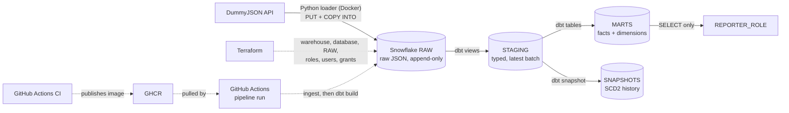

## Demo

### Production run in GitHub Actions

| Ingestion: one batch per run, row counts verified | dbt build: 38 / 38 passed |
| --- | --- |
| 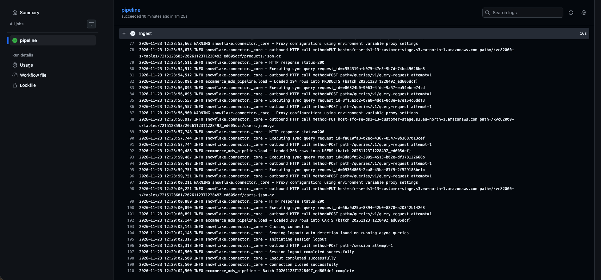 | 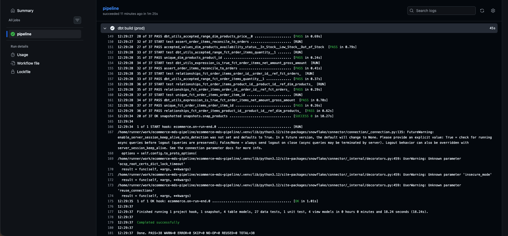 |

**CI on every PR and push to main.** Four parallel checks; the image is published
only when all of them pass:

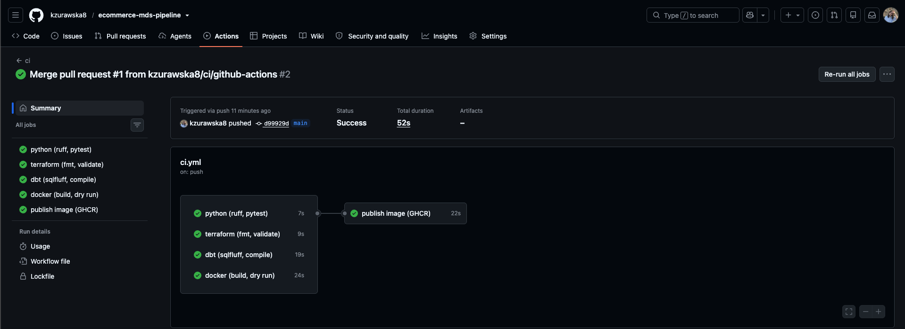

### Data in Snowflake

| Schemas built by Terraform (RAW) and dbt | RAW keeps every batch (append-only) |
| --- | --- |
| 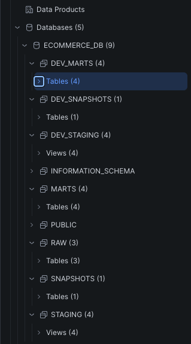 | 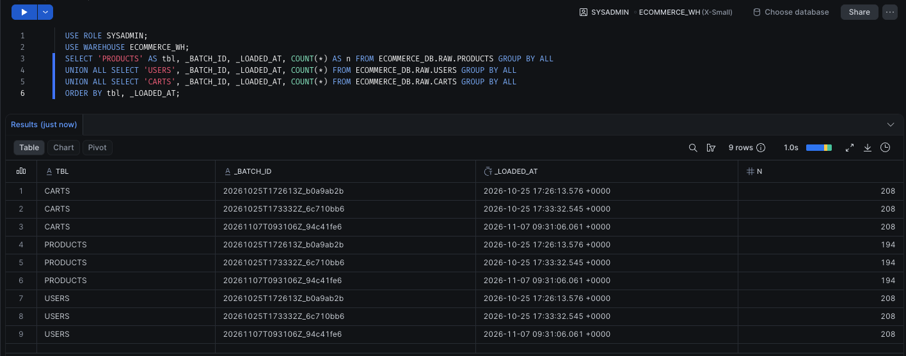 |

| Marts answer business questions | Product history as SCD Type 2 |
| --- | --- |
| 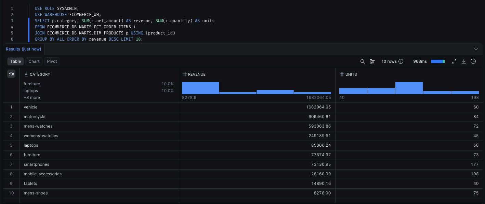 | 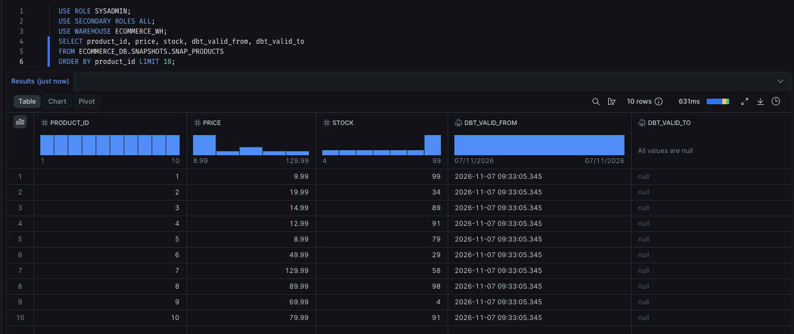 |

### Least privilege, verified

| REPORTER_ROLE: only the marts | ...and RAW is out of reach |
| --- | --- |
| 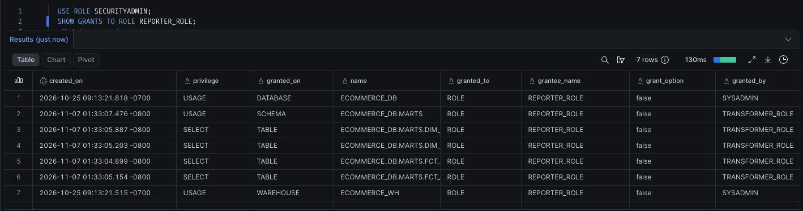 | 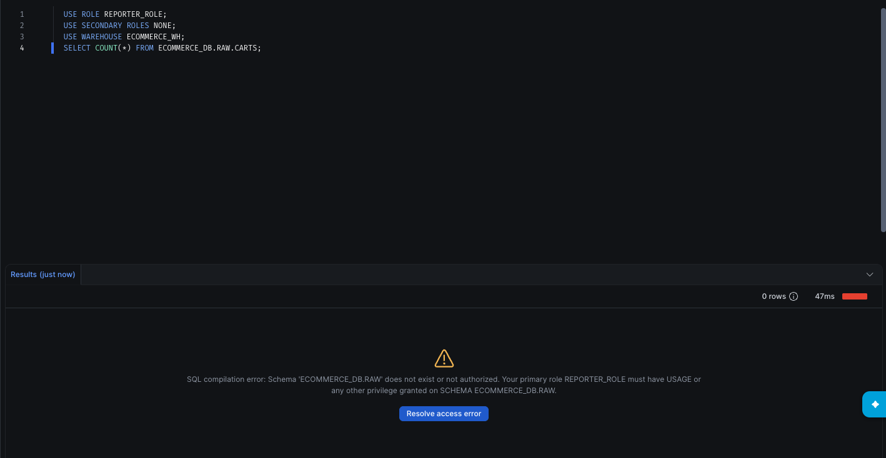 |

### Cost and observability

The whole project, from first `terraform apply` to the last run, used about
**0.3 credits**. Every query is tagged with its workload.

| Credits used | Budget cap (resource monitor) |
| --- | --- |
| 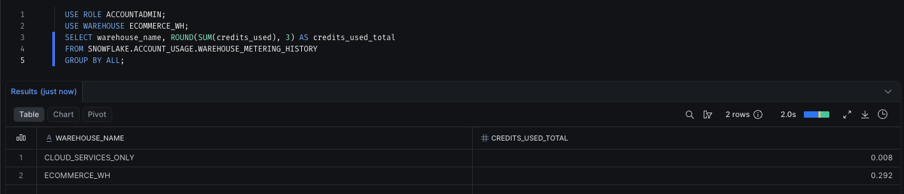 | 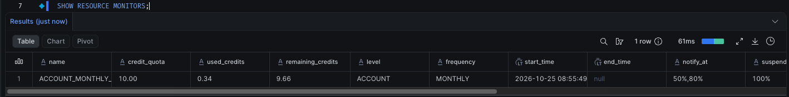 |

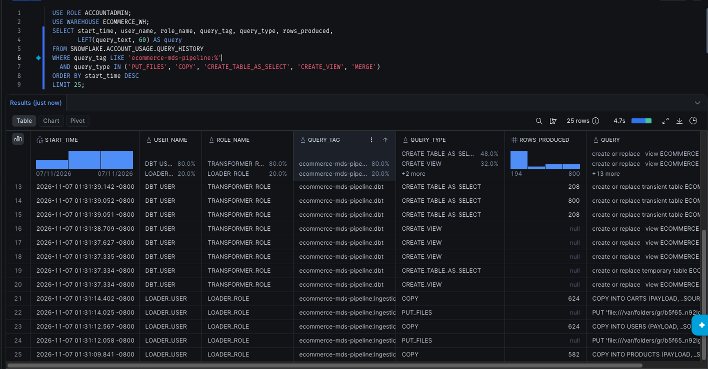

### dbt lineage

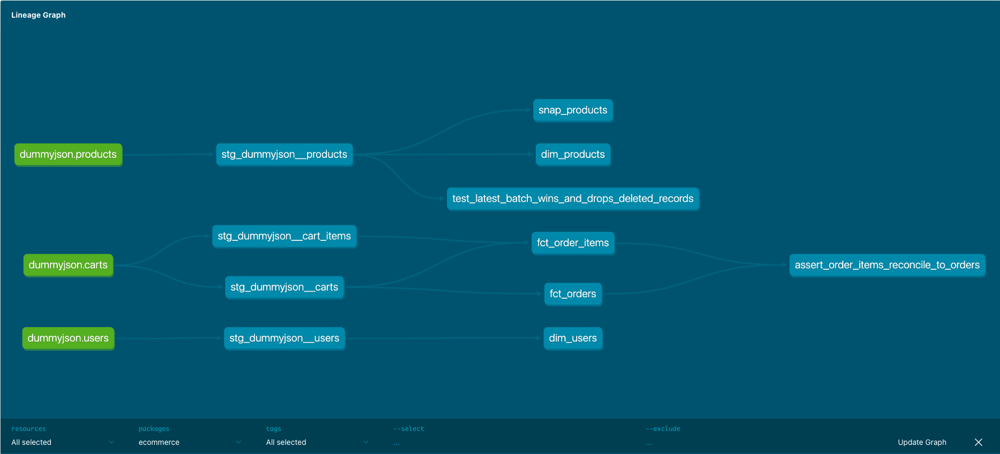

## Tech stack & skills demonstrated

| Area | Technology |
|---|---|
| Infrastructure as code | **Terraform** (`snowflakedb/snowflake` provider 2.x), lock file committed |
| Warehouse | **Snowflake**: RBAC, service users, key-pair auth, managed-access schema, resource monitor |
| Ingestion | **Python 3.12**, `requests` with retries, Snowflake connector 5.x, `uv` |
| Containerization | **Docker** multi-stage build, non-root user, published to **GHCR** |
| Transformation | **dbt Core 1.12** + dbt-snowflake, `dbt_utils` |
| Data quality | dbt data tests, unit test, model contracts, source freshness, reconciliation test |
| CI/CD | **GitHub Actions**: ruff, pytest, `terraform validate`, sqlfluff, `dbt compile`, Docker dry run; actions pinned to SHAs, Dependabot |
| Docs | dbt docs on **GitHub Pages** |

## How it works

### 1. Infrastructure (Terraform)

| Object | Name | Details |
|---|---|---|
| Warehouse | `ECOMMERCE_WH` | X-Small, auto-suspend 60 s, starts suspended, 1 h statement timeout |
| Database / schema | `ECOMMERCE_DB.RAW` | Managed-access landing zone |
| Roles | `LOADER_ROLE`, `TRANSFORMER_ROLE`, `REPORTER_ROLE` | One per workload, all rolled up to `SYSADMIN` |
| Service users | `LOADER_USER`, `DBT_USER` | `TYPE = SERVICE`, key-pair only, no secondary roles |
| Resource monitor | `ACCOUNT_MONTHLY_BUDGET` | 10 credits/month, suspends compute at 100 % *(bootstrap SQL)* |

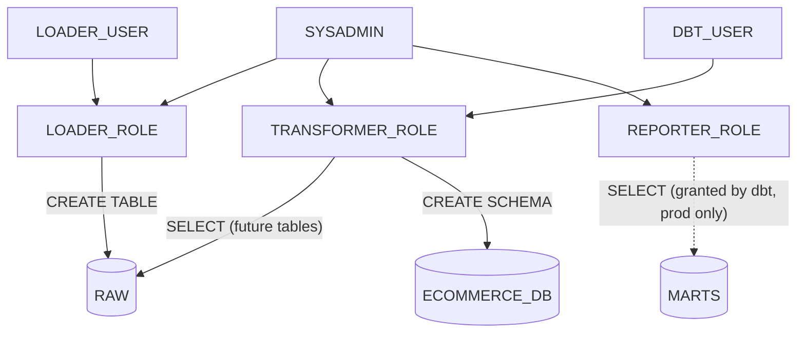

| Role | Can | Cannot |
|---|---|---|
| `LOADER_ROLE` | Create and write tables in `RAW` | Read or create anything outside `RAW` |
| `TRANSFORMER_ROLE` | Read `RAW`, create and own the dbt schemas | Write to `RAW` |
| `REPORTER_ROLE` | Read prod marts | See `RAW` or staging |

### 2. Ingestion (Python + Docker)

1. Pulls `products` (194), `users` (208) and `carts` (208) from the DummyJSON API,
   paginating and checking the count against the API's `total`. User passwords are
   dropped before anything leaves the process.
2. Only after **all** resources are extracted does it connect to Snowflake, so an
   API failure never leaves a half-loaded batch.
3. Each record is wrapped in an envelope (`payload`, `_source`, `_batch_id`,
   `_loaded_at`), written as NDJSON, `PUT` to the table's stage and loaded with
   `COPY INTO` (`ON_ERROR = ABORT_STATEMENT`).
4. The `rows_loaded` reported by COPY must equal the records sent, or the run fails.

### 3. Transformation (dbt)

| Layer | Models | Materialization |
|---|---|---|
| Staging | `stg_dummyjson__products`, `__users`, `__carts`, `__cart_items` | views |
| Marts | `dim_products`, `dim_users`, `fct_orders` (grain: order), `fct_order_items` (grain: order line) | tables, enforced contracts |
| Snapshot | `snap_products` (price, discount, stock) | SCD Type 2 |

Tests: `unique` / `not_null` on keys, `relationships`, `accepted_values`,
`dbt_utils` range and expression tests, a singular test that every order equals the
sum of its lines, a unit test for the latest-batch logic, and source freshness on
`_loaded_at`. Dev builds go to `DEV_*` schemas, prod to `STAGING` / `MARTS` /
`SNAPSHOTS`.

### 4. CI/CD (GitHub Actions)

- **`ci.yml`** (every PR and push to `main`): ruff + pytest, `terraform fmt` +
  `validate`, sqlfluff + `dbt compile`, Docker build + `--dry-run`. None of it needs
  Snowflake, so CI keeps working without an account. On `main`, a green run
  publishes the image to GHCR tagged with the commit SHA and `latest`.
- **`daily.yml`** (production run): pulls the image, runs the ingestion, then
  `dbt source freshness` → `dbt build --target prod` → `dbt docs generate`. Secrets
  live in a `production` environment that only `main` can use. The cron schedule
  is commented out because the trial account has ended; the workflow was run
  manually (screenshots above).

## Design decisions

**Key-pair auth, service users only.** Automation users are `TYPE = SERVICE` and
can't use passwords. Private keys are passphrase-encrypted and never stored
unencrypted: locally the passphrase is entered with `read -rs`, in CI it's a
separate secret from the key.

**Terraform never holds `ACCOUNTADMIN`.** The Terraform user and the resource
monitor (which needs `ACCOUNTADMIN`) are created once by a bootstrap script.
Terraform then runs with `SYSADMIN` for objects and `SECURITYADMIN` for roles and
grants, through two provider aliases.

**Terraform owns the landing zone; dbt owns its schemas.** Only `RAW` is defined in
Terraform. dbt creates its own schemas, so dev and prod build in isolation without
an infrastructure change per model layer. A future grant makes every new RAW table
readable by dbt with no manual `GRANT`.

**Least privilege, checked, not assumed.** `LOADER_ROLE` started with
`CREATE STAGE` / `CREATE FILE FORMAT`; once the loader turned out to need only
table stages, both were removed. `REPORTER_ROLE` was tested with
`USE SECONDARY ROLES NONE`, because Snowflake human users have all their roles
active by default, which would otherwise hide a missing restriction.

**ELT with schema-on-read.** Raw JSON lands untouched in a `VARIANT` column.
Typing and renaming happen in dbt, so a source schema change never breaks
ingestion, and every model can be rebuilt from RAW.

**Append-only, full snapshot per run.** RAW is never updated or deleted. Staging
keeps the **latest batch as a whole**, not the latest row per id: each batch is a
complete snapshot, so per-id deduplication would keep records that were deleted at
the source. A unit test pins this behaviour down.

**Bulk load, verified.** `PUT` + `COPY INTO` is Snowflake's bulk path: atomic per
table, and COPY's load metadata prevents loading the same file twice on a retry.
Counts are checked against the API's `total` and COPY's `rows_loaded`.

**Data minimisation.** The source users contain (fake) SSNs, bank cards, emails and
addresses. Staging selects only analytical attributes, so `dim_users` is
pseudonymous and nothing downstream can expose personal data.

**Contracts on the public interface.** Marts have enforced contracts, so a build
fails before replacing a table whose columns or types have drifted. Snowflake
doesn't enforce primary keys, so uniqueness is also tested.

**Honest modelling of a gap in the data.** Carts have no date. Instead of inventing
one, orders carry `first_seen_at`, when the pipeline first loaded them, named so
nobody mistakes it for a purchase time. And because a cart can list the same
product twice (found while profiling the source), order lines are keyed by their
position in the cart, not by product.

**Cost guardrails.** X-Small warehouse, 60 s auto-suspend, 1 h statement timeout,
10 credits/month cap, and query tags per workload (`ecommerce-mds-pipeline:ingestion`,
`ecommerce-mds-pipeline:dbt`) for cost attribution.

**Build once, run what was tested.** The production run uses the image CI built and
tested from `main`, not a fresh build. The ingestion image contains only runtime
dependencies (no dbt, no dev tools) and runs as a non-root user.

**Pinned versions everywhere.** Python 3.12, `uv.lock`, the Terraform lock file,
`dbt/package-lock.yml`, the uv image tag, and GitHub Actions pinned to commit SHAs
(kept current by Dependabot).

## Run it

**Prerequisites:** a [Snowflake account](https://signup.snowflake.com/),
[Terraform](https://developer.hashicorp.com/terraform/install) ≥ 1.6,
[uv](https://docs.astral.sh/uv/), Docker, `openssl`.

1. **Key pairs** (asks for a passphrase for each):
   ```bash
   ./scripts/generate_keypair.sh terraform_svc
   ./scripts/generate_keypair.sh loader_user
   ./scripts/generate_keypair.sh dbt_user
   ```
2. **Bootstrap Snowflake once:** in a Snowsight worksheet as `ACCOUNTADMIN`, run
   [`terraform/bootstrap/bootstrap.sql`](terraform/bootstrap/bootstrap.sql) with the
   `terraform_svc` public key pasted in.
3. **Provision:**
   ```bash
   cp terraform/terraform.tfvars.example terraform/terraform.tfvars   # fill in org and account name
   read -rs SNOWFLAKE_PRIVATE_KEY_PASSPHRASE && export SNOWFLAKE_PRIVATE_KEY_PASSPHRASE
   terraform -chdir=terraform init
   terraform -chdir=terraform plan -out=tfplan
   terraform -chdir=terraform apply tfplan
   ```
4. **Configure:** `cp .env.example .env` and fill it in. Passphrases never go in
   `.env`; export them in the shell:
   ```bash
   read -rs SNOWFLAKE_PRIVATE_KEY_FILE_PWD && export SNOWFLAKE_PRIVATE_KEY_FILE_PWD
   read -rs DBT_SNOWFLAKE_PRIVATE_KEY_PASSPHRASE && export DBT_SNOWFLAKE_PRIVATE_KEY_PASSPHRASE
   ```
5. **Ingest**, locally or in Docker:
   ```bash
   uv sync
   uv run --env-file .env ingest

   docker build -t ecommerce-ingest .
   docker run --rm --env-file .env \
     -e SNOWFLAKE_PRIVATE_KEY_FILE=/secrets/loader.p8 \
     -e SNOWFLAKE_PRIVATE_KEY_FILE_PWD \
     -v "$PWD/keys/loader_user_rsa_key.p8:/secrets/loader.p8:ro" \
     ecommerce-ingest
   ```
6. **Transform:**
   ```bash
   uv run --env-file .env dbt deps
   uv run --env-file .env dbt build                  # dev: DEV_* schemas
   uv run --env-file .env dbt build --target prod    # prod: STAGING / MARTS / SNAPSHOTS
   ```
7. **Checks without Snowflake** (what CI runs):
   ```bash
   uv run ruff check && uv run ruff format --check && uv run pytest
   uv run sqlfluff lint dbt/models dbt/tests
   uv run ingest --dry-run
   ```

For the GitHub Actions production run, create a `production` environment limited
to `main` with the secrets `SNOWFLAKE_ACCOUNT`, `LOADER_PRIVATE_KEY`,
`LOADER_PRIVATE_KEY_PASSPHRASE`, `DBT_PRIVATE_KEY` and `DBT_PRIVATE_KEY_PASSPHRASE`.

## Project structure

```
.
├── terraform/                     # Snowflake infrastructure
│   ├── bootstrap/bootstrap.sql    # one-time: Terraform user + resource monitor
│   ├── providers.tf               # SYSADMIN / SECURITYADMIN provider aliases
│   ├── warehouse.tf, database.tf, roles.tf, users.tf, grants.tf
│   └── .terraform.lock.hcl
├── src/ecommerce_mds_pipeline/    # Python loader
│   ├── extract.py                 # API client: pagination, retries, completeness check
│   ├── load.py                    # PUT + COPY INTO, row-count verification
│   ├── config.py                  # settings from environment variables
│   └── cli.py                     # `ingest` entry point (--dry-run)
├── tests/                         # pytest unit tests
├── Dockerfile                     # multi-stage, non-root runtime image
├── dbt/
│   ├── models/staging/dummyjson/  # sources, staging views, unit test
│   ├── models/marts/              # facts and dimensions with contracts
│   ├── snapshots/                 # SCD2 product history
│   ├── tests/                     # singular reconciliation test
│   ├── macros/                    # schema naming, latest batch, grants
│   └── profiles.yml               # dev / prod targets, all secrets from env vars
├── .github/workflows/
│   ├── ci.yml                     # checks + image publishing
│   └── daily.yml                  # production run: ingest -> dbt build
├── docs/                          # GitHub Pages: dbt docs + screenshots
└── scripts/generate_keypair.sh    # encrypted RSA key pairs
```

## Limitations and next steps

- **Static source.** DummyJSON returns the same data every day, so batches repeat
  and the snapshot holds one version per product. The mechanisms (append-only
  batches, latest-batch logic, SCD2) are built for changing data.
- **Local Terraform state.** In a team this would be a remote backend with locking.
- **Slim CI.** With a live account, CI would build only changed models against a
  CI schema (`dbt build --select state:modified+ --defer`).
- **dbt v2.** The project uses dbt Core 1.12 with no deprecation warnings, which is
  the documented path to the new dbt v2 engine.

---

*A portfolio project exploring the Modern Data Stack: Terraform, Snowflake and dbt.*
